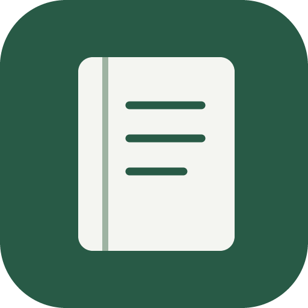
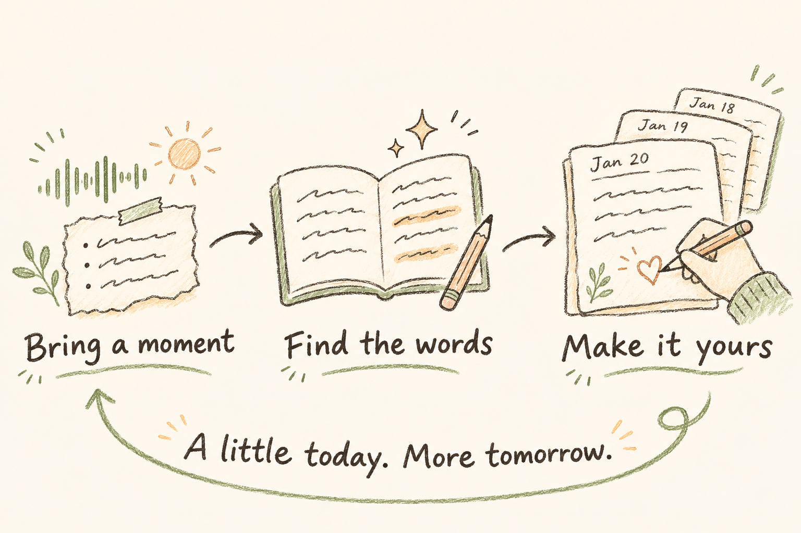

# narihitos-diary-gui

> Three minutes for today. A diary for years.

  

Set aside three minutes for your day. Bring a recording or a few notes, let AI help with a draft, and make it yours. Narihito's Diary is your calm Mac workspace for turning everyday moments into something worth keeping.

## Start small. Keep your story.

The funny thing someone said. A small win. An ordinary afternoon you might otherwise forget. You already have something to write about.

1. **Bring a moment.** Import a recording or a written snippet.
2. **Find the words.** Let AI help turn your material into a draft.
3. **Make it yours.** Review, edit and keep the words that feel right.

A few lines are enough. Come back tomorrow.

Your diary stays local-first, with export to iCloud or Notion when configured. AI offers suggestions; you choose what stays and where your writing goes.

## Main features

- Edit durable diary entries with autosave and recovery safeguards.
- Import recordings and text snippets, then draft from the material you select.
- Use configurable AI Agents for chat, draft generation and paragraph-level suggestions; accept or reject every proposed change.
- Organize work by date, recover interrupted source moves, and export finished entries to iCloud or Notion when configured. Upload a published Illustrated diary to its own Notion day page with text and resized JPEG photos.

- [User guide](docs/user-guide.md): installation, workflows, recovery and current limits
- [Setup and development](docs/contribution-guide.md#setup-and-development)
- [Roadmap](docs/roadmap.md) and [all docs](docs/README.md)

## License

Apache-2.0. See [LICENSE](LICENSE) and the [third-party notices](third-party-notices.md).

## Contributing

See [AGENTS.md](AGENTS.md) and the [contribution guide](docs/contribution-guide.md).

The server can create an **Illustrated diary** from a saved Authentic entry: AI Agent theme analysis and rewritten text plus one photo per resulting theme group, combining related groups to the configured cap (default four). The AI Agent is instructed to include every configured image prompt directive in each photo prompt. Complete versions are stored as Markdown and a photo directory, separately from Authentic. Replacement is silent after successful generation; deletion requires confirmation. Use **Create Illustrated Diary** from the toolbar or Command palette, follow progress in AI Activities, and read the result in its own rendered, read-only tab. Failed viewer refreshes retain readable text and suspend photos until recovery; tabs can close during pending reads. The dedicated Illustrated Explorer tab lists saved versions; Settings > AI Agents checks image engine readiness automatically in the background and reports problems in Global Messages; Check retries a probe. Server shutdown also stops active image engines. The Krea 2 factory image size is 624 × 832 pixels (3:4 portrait), with no upscaling. See the [user guide](docs/user-guide.md#illustrated-diaries) and isolated [smoke procedure](docs/smoke-tests.md).
