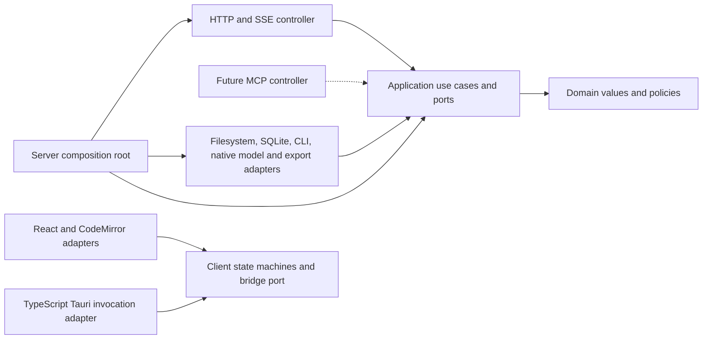
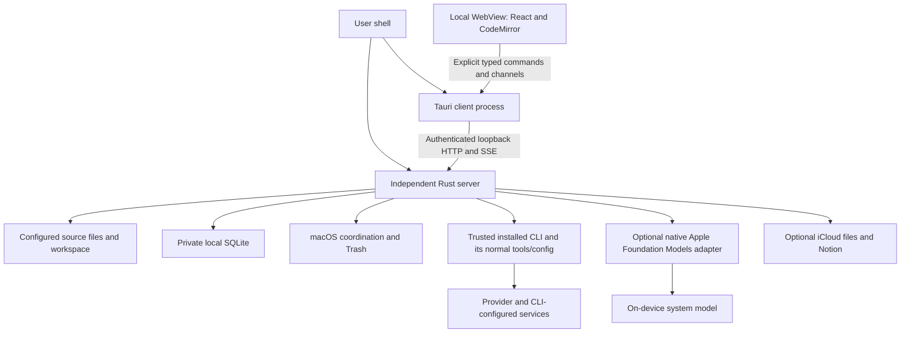
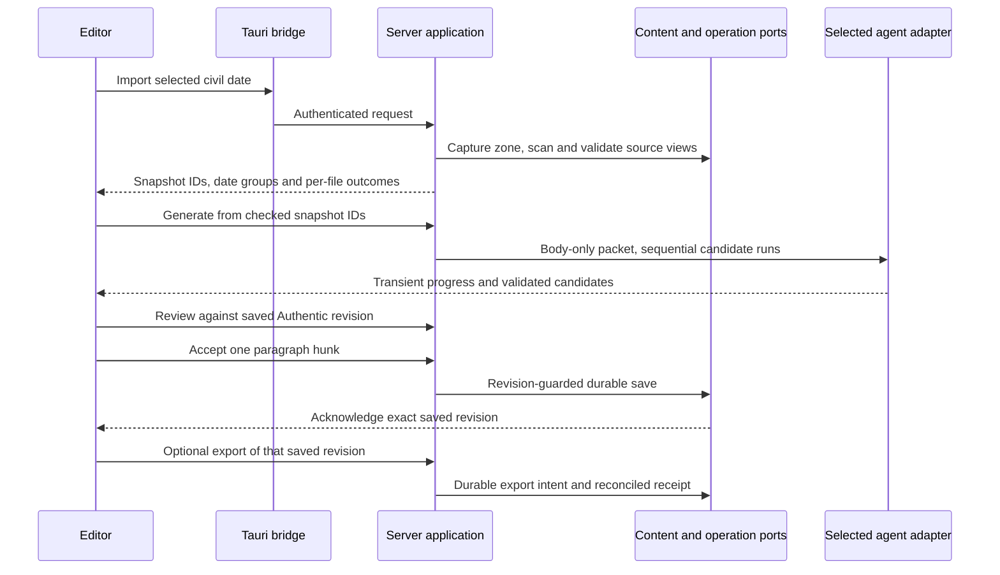

# Software architecture

Status: Active

This is the target architecture for Narihito's Diary, the GUI, using Clean Architecture. It defines a personal, local macOS application; implementation and runtime acceptance remain separate from this design.

## Constraints and document map

[Product behavior](product-behavior.md) defines the owner requirements. Engineering choices here specify their internal implementation: one workspace, one client, separately launched Rust server and Tauri client, React/TypeScript, and CodeMirror 6. Only Diary assets are implemented; financial assets, history, remote clients, and MCP serving are future extensions. Reference repositories are evidence, never runtime dependencies.

| Contract                                                                             | Maintained document                                                    |
| ------------------------------------------------------------------------------------ | ---------------------------------------------------------------------- |
| Launch, discovery, authentication, commands, HTTP, SSE, jobs and errors              | [API and processes](architecture/api-and-processes.md)                 |
| Domain types, Markdown, SQLite, autosave, locking and recovery                       | [Domain and persistence](architecture/domain-and-persistence.md)       |
| Path identity, source parsing/save/Trash, timestamps and civil dates                 | [Sources and dates](architecture/sources-and-dates.md)                 |
| Editor ownership, paragraph review, CLI/native agents, prompt assets and supervision | [Editing and agents](architecture/editing-and-agents.md)               |
| Nonblocking AI work, progress, streaming, cancellation and completion attention      | [Background AI experience](architecture/ai-job-experience.md)          |
| Diagnostic logs, 3-day rotation and redaction                                        | [Logging](architecture/logging.md)                                     |
| GUI actions, default shortcuts, Settings Keyboard Shortcuts table                    | [Keyboard shortcuts](architecture/keyboard-shortcuts.md)               |
| Persistent GUI-editable settings apart from private config                           | [User settings](architecture/user-settings.md)                         |
| Private configuration, exports, versions, platform and dependency candidates         | [Configuration and exports](architecture/configuration-and-exports.md) |

These documents are engineering decisions within the approved product scope. A chosen interface or algorithm does not prove macOS access, producer interoperability, CLI behavior, or service recovery. Each theme states the evidence needed before enabling its conditional capability.

## Dependency rule

Source dependencies point inward. Domain code contains values and invariants, with no Tauri, HTTP, SQLite, filesystem, CLI, React, or serialization types. Application code implements use cases and owns the ports it needs. Adapters translate protocols and implement ports; composition roots supply concrete implementations. Domain failures become application errors before transport-specific mapping.

An adapter implementing an application-owned port imports its interface; application code never imports the adapter. Runtime calls can flow outward through that port. The TypeScript invocation adapter implements the client port and calls the separate Rust bridge through IPC; Rust does not import TypeScript application code. HTTP DTOs and persisted records are separate from domain values, with validation at conversion boundaries. Avoid a generic repository or service locator that hides these dependencies.

## Deployment and trust boundaries

The server owns all domain operations, workspace state, credentials, source/export access, and agent descendants. The Tauri Rust bridge holds only the API credential and session, forwards typed requests, and renders OS symbols. The WebView receives redacted DTOs and body text, never tokens, arbitrary filesystem access, shell execution, or SQL. Loopback authentication protects access by other local applications; it cannot defend against a same-user hostile process able to read the private config/runtime directory.

The CLI is trusted under the owner's account policy. Filtering the app's prompt/environment reduces accidental disclosure; it cannot confine installed hooks, tools, MCP, filesystem access, or provider retention. Apple Foundation Models is a separate optional native adapter using the on-device system model; its availability and lifecycle must be verified independently. App-authored instructions come from [prompt assets](../assets/prompts/README.md), never source-code literals. Markdown stays source text: no HTML preview, automatic network images, or executable links.

## Component allocation

Proposed module locations are a scaffold contract, not a repository restructure already performed:

| Location                                | Responsibility and dependency constraints                                                                                         |
| --------------------------------------- | --------------------------------------------------------------------------------------------------------------------------------- |
| `src-tauri/crates/diary-domain`         | Asset/date/revision values, review alignment and selection/order policies; standard-library-oriented pure code                    |
| `src-tauri/crates/diary-application`    | Use cases; ports for content, catalog, operations, sources, clock/zone, agent runner, exports and event sink; depends on domain   |
| `src-tauri/crates/diary-infrastructure` | Port implementations, platform/file/DB/provider/CLI/native model adapters and prompt asset loading; depends on application/domain |
| `src-tauri/crates/diary-api`            | HTTP/SSE DTO conversion, auth/session admission and error mapping; depends on application                                         |
| `src-tauri/crates/diary-server`         | Server executable and composition root                                                                                            |
| `src-tauri/src`                         | Tauri client composition, narrow HTTP bridge, shutdown handshake and native symbols; no server/domain implementation              |
| `src/application`                       | Client reducers, save/review/session state machines, command registry and typed bridge interface                                  |
| `src/adapters`                          | Tauri invocations, channel subscription and DTO validation                                                                        |
| `src/editor`                            | Dedicated CodeMirror state/view/extensions and transaction translation                                                            |
| `src/components`                        | React layout and accessible controls from the canonical [containment model](ux-information-architecture.md)                       |

Use a Cargo workspace rooted at `src-tauri/Cargo.toml` whose default members include the client, server and all Rust crates. This preserves the existing gate command paths while covering the server. Feature code never imports a reference submodule or a transport adapter from the domain/application crates. Architectural tests should reject forbidden dependencies and verify both binaries are included in gate coverage.

## Principal data flow

All UI-to-server arrows pass through the explicit bridge. A saved Authentic revision, source observation, candidate, and editor buffer are distinct objects. Only acknowledged Authentic changes are durable; source changes require explicit Save. Export never controls whether local autosave succeeds. Pending review/chat/candidate text has no app-owned durable representation.

## Failure containment and extension seams

Serialize writes per resource, use revision preconditions and durable operation IDs, and reconcile uncertain outcomes before retrying. SQLite transactions cannot atomically include file or remote-service writes. Recovery inspects durable intents and actual results; it never overwrites unexpected bytes to force a presumed outcome. A corrupt authoritative database blocks mutation while leaving readable Markdown available. Watchers and SSE are hints; fresh reads and status queries establish state.

Durable operation lookup survives session/job loss; continuation steps are independently deduplicated. Quarantined work retains its resource reservations so a new operation ID cannot bypass an uncertain side effect. Saved export snapshots release the live editor resource before remote work. Queue/memory/log bounds reject or drop only the relevant optional work while preserving status, cancellation and local-save progress. Settings corruption and diagnostic failures never establish a content-save result.

Optional agent/export failures leave import and editing usable. No selected profile, missing binary, unavailable native model, or unsupported source format silently falls back to another provider or destructive writer. New MCP/web controllers would call the same use cases with their own authentication and session policy; enabling them would require a separate design. A CLI consuming its own MCP configuration does not mean Diary serves MCP.

Long-running AI jobs keep session/date ownership independently of mounted views. The [background experience](architecture/ai-job-experience.md) keeps the editor responsive, reports observed stages and completed counts, and makes cancellation/results discoverable without moving focus. Provider latency and silence never imply a saved entry or successful candidate. Completion feedback stays inside the app.

The single-writer API and port boundaries add code compared with an in-process Tauri backend, but satisfy independent server lifetime and reusable domain behavior. Markdown keeps content portable; SQLite provides durable recovery/receipts without introducing user-facing history. Neither global event replay nor generic plugin execution is required.
