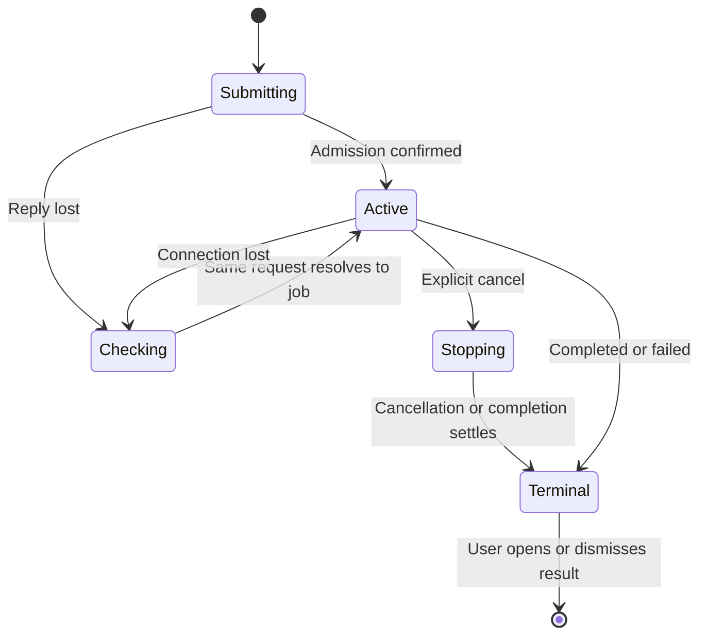

# Background AI job experience

Status: Active

This contract keeps long-running generation and chat visible while the user continues working. It extends the [agent lifecycle](editing-and-agents.md) and [HTTP/SSE job contract](api-and-processes.md), within the existing Standard Layout; it specifies target behavior, not implemented performance.

## Interaction choices and ownership

The owner chose generation that continues across date changes, in-app feedback without macOS notifications, and regeneration before review when the saved Authentic baseline changes. A background job remains owned by its live client session, not by the mounted editor or currently selected date. Closing the client, lease expiry and server shutdown still cancel runs; this is not a resumable offline agent service.

The Main Toolbar Strip’s AI Activities button opens a viewport-bounded modal with run details, elapsed time, completed counts, Cancel and result access. Plain-language guidance and bitmap info buttons explain progress, cancellation and temporary results in separate overlays. The bottom status line shows a brief current activity or idle/unread summary, qualifying disconnected observations as unavailable. AI Chat fills the AI column. Closing the activity modal keeps the run alive and returns focus to its invoker; successful View results closes it after guarded navigation succeeds. Completion feedback in Global Messages stays mounted independently of the modal. This owner-requested placement supersedes the earlier toolbar disclosure and widget layouts; see [P1-M29](../archive/milestones/p1-m29/milestone-29-owner-requested-revisions-overview.md).

An active-generation summary might read `Generating for 2026-11-05 · candidate 2 of 3 · 1 ready · 00:42`. Details show the selected profile alias, Writing Language, origin date, requested/finished/ready/failed counts, current stage, elapsed time, last observed agent activity and Cancel. Labels identify observed facts. They never expose prompts, raw tool activity, reasoning, private paths or stderr.

## Immediate response and continued work

On Generate or Send, show a local `Submitting…` state immediately, retain the user's context and prevent duplicate activation of that same request. Aim to display local acknowledgement within 100 ms in the supported packaged environment; this is a measured UI target, not a provider deadline. Server admission returns a job handle without waiting for inference. Only that acknowledgement changes the label to an admitted state. An admission timeout means `Checking whether the request started…`, not proof of failure: resend the same session-scoped request ID to recover the existing handle before offering a new request.

No global busy overlay or application-wide disabled state is used. Date navigation, source reading/editing, Authentic editing/autosave, Create Empty, settings and pane controls remain available under their own normal guards. Changing date may still wait for actual pending saves or an admitted paragraph acceptance; AI latency itself never blocks it. Starting generation captures immutable source/context/baseline data, then releases editor/file locks before invoking the adapter.

The single active agent run remains client-wide. A generation owns that reservation across all of its sequential candidates, including validation and the interval between candidates. Generate/Send for another date/chat explains `An AI run is active for <date or chat>; view it or cancel it.` It does not silently enqueue, cancel the current run, switch providers or discard the user's composed message. Typing a future chat message remains possible; sending waits until the existing run settles. Each admitted user chat message appears exactly once with its turn status; a lost admission reply cannot append it twice.

## Truthful state and delay feedback

Lifecycle state, execution stage and observation freshness are separate fields. A connected bridge is not evidence that the model is advancing. Stage labels come from verified adapter/application transitions, never generated progress narration.

| Condition                                   | Display / controls                                                                                           |
| ------------------------------------------- | ------------------------------------------------------------------------------------------------------------ |
| Local request not acknowledged              | Submitting; preserve input; resolve the same request ID after a timeout                                      |
| Admitted and preparing                      | Preparing selected snippets / Starting agent; indeterminate activity and Cancel                              |
| Agent started, no output                    | Waiting for agent output; elapsed time and last observed activity; Cancel                                    |
| Validated output events arriving            | Receiving candidate N of M or Receiving reply; bounded provisional preview when available                    |
| Process/native result awaiting final checks | Validating candidate N of M; output is not reviewable yet                                                    |
| One candidate complete, others remain       | Ready/failed counts plus current candidate stage; completed valid candidates can be read immediately         |
| No meaningful agent activity for 30 seconds | Still waiting for agent output; last-activity age and Cancel; no assertion that it is frozen                 |
| Connection lost or session state unknown    | Connection lost — checking run status; retain observed state marked stale; do not imply the run stopped      |
| Cancellation requested                      | Stopping…; preserve completed candidates; no new run until terminal acknowledgement                          |
| All work terminal                           | N ready / M failed, Completed, Cancelled, or typed failure; Open candidates or explicit retry as appropriate |

Thirty seconds is an engineering hint threshold, not a new timeout or promise of normal runtime. Keep the existing 120-second inactivity and 10-minute wall deadlines; real protocol activity, not an SSE heartbeat or UI timer, updates agent activity. If an adapter cannot stream progress, show the known stage and elapsed time until its final result. Never invent substeps, token counts, percentage or time remaining. `1 of 3 finished` measures completed candidate outcomes, not one-third of the execution time. Failure/cancellation counts are explicit, not counted as successful candidates.



Changing dates is deliberately absent from the job state machine: it changes presentation selection, not job ownership.

## Streaming and useful partial results

Stream chat/candidate previews only from supported adapter output events. Show them as provisional and read-only until final schema validation and successful CLI/native completion. Partial JSON, raw provider records and reasoning are never rendered as diary text. An adapter that returns one final response still receives the complete pending/progress/cancel experience.

Generation continues its admitted sequential count. Publish each independently validated candidate with `candidate_ready`; a later failure does not remove earlier candidates. The job succeeds with explicit partial counts if at least one candidate is valid when the requested count finishes; zero valid candidates is failure. Cancel stops remaining work, retaining completed candidates and labeling the interrupted candidate and unstarted slots separately. A failed/incomplete preview cannot be accepted, exported or autosaved. No hidden repair/model retry occurs. Explicit generation again is a new request; show its captured profile/count/selection rather than replaying an unknown outcome. If retained results exhaust the session budget, offer explicit Discard results for completed jobs before another admission. Dismissing a completion notice alone never deletes candidates. Discard removes only that session-owned transient result, never Authentic/source files, and waits for any active review/accept using it to settle.

Keep the user's position while text arrives: follow appended text only when already at the end; scrolling away disables following and exposes a New output affordance. Preserve selection and scroll across updates. Progress and candidate arrival never focus the preview, move the caret in Authentic, open a tab automatically or overwrite editor text.

## Dates, baseline changes and completion attention

Route every job/result by `{instance_id, session_id, job_id, origin_date or chat_id}`. A date change is not a superseded run. Continue processing its events even when its originating editor is not mounted; only matching session/run cancellation epochs or terminal sequences suppress stale events. Returning to a date shows its retained candidate cards and readiness state.

The user may edit the same date during generation. If its saved Authentic revision changes, mark the generation/candidates `Entry changed — regenerate to review`; keep them readable, but require a new generation against the latest saved baseline before review. Do not auto-merge, silently rebase, lock the editor for generation, or make an extra model call. A dirty buffer must be flushed/reconciled before the server's final review precondition check. Paragraph review itself retains its separate manual-edit pause.

On a terminal outcome, update the bottom status/result indicator and issue one polite in-app completion message such as `2 candidates ready; 1 failed`. A View results action performs navigation only when selected, after normal unsaved-edit/save guards. The result indicator remains discoverable until opened or explicitly dismissed, even if the brief message has expired or the app was unfocused. Deduplicate messages by instance/session/job/terminal sequence during the live session. On a fresh frontend baseline in the same surviving session, restore retained terminal results indicators silently without replaying historical completion messages or accessibility announcements. After that baseline, a completion first observed following a temporary disconnect announces once. Candidate arrival updates counts; it does not generate a toast for every token or candidate. No macOS notification, sound or automatic focus is requested.

Elapsed time comes from server-observed duration, advanced locally using a monotonic clock between snapshots. Stop the display timer at terminal completion. On app activation or after sleep, refresh job status before claiming it is still active; a suspended heartbeat may have expired the lease. A restarted server loses transient jobs/candidates. Show Interrupted/results unavailable when established by the handshake; do not replay inference automatically or suggest that an endlessly animated spinner represents a surviving run.

## Ports, DTOs and execution isolation

The application owns job orchestration and its progress projection; adapters report bounded typed milestones and text deltas through the existing event sink. `AgentRunner` never calls React or a view directly. A progress snapshot contains:

```text
job_id, request_id, instance_id, session_id, kind, origin_date?/chat_id?,
state, phase, job_sequence, profile_id, locale, baseline_revision?,
candidate_index?, requested_count?, finished_count?, ready_count?, failed_count?,
cancelled_count?, not_started_count?,
elapsed_ms, last_agent_activity_at?, cancellation_requested,
candidate_ids, error_code?
```

`phase` is a closed enum: `preparing_context`, `starting_agent`, `waiting_for_output`, `receiving_output`, `validating_output`, `between_candidates`, `stopping`, `finished`. Never accept arbitrary adapter text as a phase label. Client-only `submitting`, `checking`, `connected/stale` and unread state are presentation state, not invented server outcomes. Progress DTOs contain no source bodies or raw diagnostics; candidate bodies use their bounded individual read command. Stream previews use the existing content-bearing delta contract, not diagnostic logs.

Add typed `list_jobs` for bounded, paginated session reconciliation and return the same complete progress snapshot from `get_job`. `discard_transient_result` removes a terminal job's result only for its owning live session, retaining its content-free session admission record so a later retry cannot rerun inference. Admission requests use a session-scoped request UUID and normalized input hash; deduplicate before the busy check and return the existing job on retry. A discarded result is reported unavailable, never regenerated implicitly. A disconnected client cannot safely identify a transient job by the currently selected date alone. SSE `job_changed`, `agent_delta` and `candidate_ready` carry job identity/sequence; gap handling re-reads list/status/manifests and complete results rather than reconstructing from partial deltas. No new general HTTP or shell escape hatch is introduced.

Run child/native execution, pipe draining and validation away from HTTP admission, heartbeat and SQLite workers. No inference wait holds a content lock. The Tauri bridge consumes SSE asynchronously, using bounded channels and the existing resync/backpressure contract. A client application job store lives independently of editor components; React subscribes to small immutable job snapshots, while streamed text stays in bounded per-run buffers outside global React context. Existing React primitives suffice; no state/progress library is selected. [React's external-store contract](https://react.dev/reference/react/useSyncExternalStore) requires stable cached snapshots/subscriptions if that hook is used.

Coalesce preview renders to at most ten updates per second per visible run; offscreen runs update metadata without rendering text. Show elapsed time at most once per second, without an accessibility announcement on every tick. Terminal states, cancellation and errors bypass a pending visual text batch. Keep the existing 50 ms/16 KiB server delta batching, encoded SSE/HTTP bounds, 64 MiB session budget and reserved save/control capacity; a slow renderer must not stall CLI drains or saving. These are engineering budgets to measure on the actual device, not established performance claims.

## Accessibility and evidence

Use a polite status region for admission, important stage changes and completion. Keep it outside any busy subtree that would defer its announcements. Apply busy semantics only to the candidate/chat output region, never the entire window or editor. Use named keyboard-operable Open details, Cancel and View results controls, and return focus to the invoker when details close. An indeterminate indicator has no fake numeric value; textual phase/counts remain available with reduced motion. Do not announce token deltas or every elapsed second. The owner-requested per-profile progress option below explicitly permits a two-second Global Messages cadence, including unchanged waiting stages. W3C's [status-message guidance](https://www.w3.org/WAI/WCAG22/Understanding/status-messages.html) supports status updates without moving focus. Apple's [progress guidance](https://developer.apple.com/design/human-interface-guidelines/progress-indicators) supports distinguishing measured progress from an indefinite wait; the concrete thresholds and layout above are engineering choices.

Fake-clock and fake-adapter scenarios must cover 0/30/120-second silence, all wall/lease deadlines, delayed/lost admission, duplicate activation, an adapter with no deltas, reordered/duplicate/gapped events, flooding output, partial success then cancel/failure, terminal cancellation races and stale completion. Verify date switching preserves origin/results, same-date edits require regeneration, initial locale remains snapshotted, and completion never changes focus, caret, tab, scroll or unsaved buffers. A stalled event consumer must leave heartbeat/cancel/save available. Assert zero extra inference calls and no system notification request.

Owner update (2026-11-06): P1-M23 closes on automated tests and the full gate; the packaged evidence below is explicitly required in P1-M32. Native VoiceOver proof remains exempt under the P1-M13 owner decision; automated accessibility coverage remains required.

Packaged macOS evidence must demonstrate editing and autosave during a deliberately slow synthetic run, status-line/dialog feedback, visible progress for an off-date run, keyboard/reduced-motion behavior, loss/recovery of connection and activation after sleep. Measure input-to-feedback (target 100 ms), editing responsiveness under maximum admitted streaming, cancel acknowledgement, rendering budgets and bounds separately from total provider latency. Mocks cannot establish WKWebView responsiveness or native adapter cancellation. Real-agent profiles retain their own compatibility/process/native gates.

## P1-M22 implementation status

Generation implements sequential generation and body-less progress/manifest reads, bounded provisional-result reads, candidate-ready events and terminal discard. The single AI reservation stays occupied across candidates and until cancellation acknowledgement. Counts distinguish ready, failed, cancelled and not-started slots; terminal elapsed time is frozen. Slot data, preview and progress are captured under one generation lock so concurrent output cannot create inconsistent result DTOs. The client bridge validates these shapes and bounds. A generation controller independent of editor mounts retains per-date results, keeps text in bounded output buffers and shares the client payload budget. Generate shows preparation/submission immediately, blocks another chat/generation with a visible reason, and provides cancellation and one atomic completion announcement. Read-only candidate cards preserve focus, text selection and scroll while updating; stale saved baselines show a regeneration label. The complete shared activity/reconnect and packaged performance evidence remains outside this minimal UI. See [M22 evidence](../archive/milestones/p1-m22/milestone-22-candidate-generation-overview.md#evidence-record).

During deliberate close, the client shows a closing status and prevents interaction while the server acknowledges cancellation. Failed close preserves the window and reports the failure. Ordinary AI work keeps editing and navigation available.

## P1-M23 implementation status

The application-owned activity runtime discovers chat/generation jobs through
body-less progress and a negotiated native baseline/replay boundary. Transient
transport loss preserves the owning lease; activation verifies it and reconciles
before activity becomes fresh. Confirmed replacement clears transient payloads.
Results restore silently after frontend reload, with explicit guarded View,
presentation-only dismissal and terminal generation discard. Scoped terminal
attention and shared Global Messages coordinate feedback.

Visible chat preview publications are separate from metadata and coalesced at
100 ms; generation retains its bounded output channel and immediately refreshes
terminal hints. Live metadata, staged baselines, terminal history, retry context
and retained output use the shared payload budget. Server-observed silence drives
the 30-second waiting hint. Ordinary editing remains available, and busy semantics
apply only to output. No system attention or decorative activity animation is
introduced. The milestone completed its automated acceptance audit and full gate on 2026-11-07;
see the [M23 checklist](../archive/milestones/p1-m23/milestone-23-background-ai-activity-results-overview.md).
Packaged macOS timing, sleep/reconnect and native interaction evidence remains
explicitly assigned to P1-M32 as described above.

## Per-profile progress in Global Messages

Each profile in Settings → AI Agents has a saved, default-on **Show progress using
Global Messages** toggle. For enabled profiles, ongoing jobs add a content-free
progress message every two seconds, identifying the profile, job and request turn,
and the current request/response stage. Generation also identifies the candidate
index/count when available. Stages come from authoritative activity metadata:
preparing context, starting the agent, waiting for output, receiving/validating
output, preparing the next candidate or awaiting cancellation acknowledgement.
An unknown stage remains explicitly pending; no reasoning trace or percentage is
invented. The existing 500-message session bound still applies.

The reporter reads the latest activity and feature-controller observations at each tick;
frequent observations do not postpone updates. Generate and Chat preparation/admission
and the independent Review operation use the same reporter, so enabled work keeps
a two-second cadence before and after server admission, including unchanged waits. Disabled profiles emit no periodic
messages. Terminal/finished jobs and disposal stop reporting. During stale/disconnected
observations, retained work emits an explicit status-unavailable heartbeat rather
than claiming that an observed stage is current; a fresh baseline resumes stage
reporting. Completion, warning and
error feedback remains independent. Messages contain no raw prompts, response
bodies or diary text and are not diagnostic log records.
