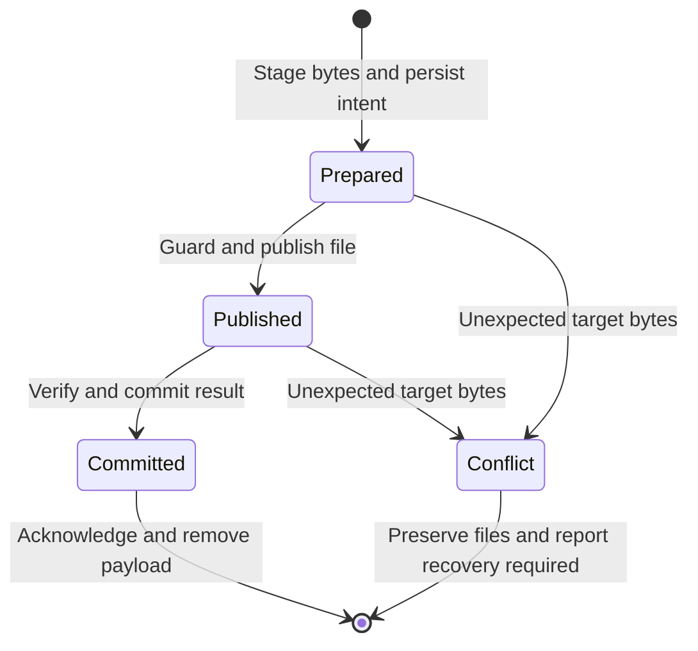

# Domain and persistence

Status: Active

This document defines domain identity, authoritative storage and durable save/recovery protocols. Use it with the [API contract](api-and-processes.md) and [source contracts](sources-and-dates.md).

## Values and ownership

| Value | Invariant |
|---|---|
| `AssetType` / `DiaryKind` | Explicit `diary`; `source_view`, `authentic`, `candidate`. Only Authentic is managed durable content. Reserve separate asset namespaces for future types. |
| `DiaryDate` | Valid Gregorian civil date, ISO text, no implicit time/UTC conversion |
| `Instant`, `ImportZone` | UTC instant and captured IANA zone with timezone-database version; never interchange date and instant |
| `AuthenticId` | Random UUID in Markdown; one date/path per workspace, unique catalog ID |
| `AuthenticRevision` | Positive sequence plus SHA-256 of complete file; creation starts at 1 |
| `SourceIdentity`, `SourceObservation` | Path-based key plus bounded fresh-read token; producer ID is metadata |
| `Candidate`, `Review` | Session-owned, fixed source/baseline snapshots, transient; cannot be exported or treated as saved content |
| `OperationId`, `JobId` | Durable action identity versus progress identity; retries reuse operation ID |

Pure domain rules enforce date validity, unique Authentic date, chronological packet order and review decisions. Application use cases authorize session/resource access and coordinate ports. Infrastructure reports observed failures rather than deciding product conflict policy.

## Workspace and file schema

`paths.entries_root` is the one workspace root, on a writable local filesystem outside cloud-synced folders. Its live database must not be replicated by iCloud. Source/export/profile/runtime/config roots are separate. Reject symlinks within the managed tree and normalized-path collisions.

```text
<workspace>/
  assets/diary/authentic/YYYY/MM/YYYY-MM-DD.md
  .diary/
    workspace.json
    workspace.lock
    state.sqlite3                 # plus SQLite WAL/SHM when present
    pending/<operation-id>.md      # staged save, only while incomplete
```

`workspace.json` is private JSON `{schema_version:1, workspace_id:<uuid>, created_at:<UTC>}`. It has no token. The OS lock covers startup recovery, all app writes, and migrations. One server owns it; a second server exits without modifying state. Directory permissions are 0700 for `.diary`, files 0600; managed content defaults to 0600. Source permissions remain producer-owned. Export files follow their destination policy.

Initialize only an empty/uninitialized destination: under the lock create/sync the private directory and database schema, then atomically publish/sync `workspace.json` last as the initialization marker. Unexpected pre-existing private files without that marker require inspection, not overwriting. Create content date directories under the same lock and sync newly created parents before acknowledging a save. Interrupted initialization must be tested independently of normal save recovery.

Authentic Markdown schema 1:

```yaml
---
schema_version: 1
asset_type: diary
kind: authentic
id: "<uuid>"
diary_date: "2026-11-05"
diary_timezone: "Asia/Seoul"
timezone_database: "<database-version>"
created_at: "2026-11-05T10:00:00Z"
updated_at: "2026-11-05T10:00:00Z"
revision: 1
---
```

Body follows the closing delimiter with one LF. New writes use UTF-8 without BOM, LF endings and fixed header order. `diary_timezone` is the zone captured for the initiating import; if no import exists, capture the system zone when the file is first created. Preserve date/zone/creation metadata on subsequent saves; sequence increases, `updated_at` is the server clock, not a sorting/identity authority. Clock regression does not decrease revision. Metadata/body/path date disagreement, duplicate IDs/dates, unknown schema, or invalid UTF-8 blocks saving with a readable diagnostic; never silently repair/migrate. Unknown bounded scalar extension fields are preserved; duplicate keys, aliases, tags and unsupported compound extensions are rejected for writing.

Loading an absent date returns a virtual empty buffer, not an empty persisted file. First nonempty edit or accepted candidate text creates it. The explicit **Create Empty** action also creates a durable Authentic file immediately for the selected date, with the normal header, empty body and revision 1; it requires no snippets or agent and is listed after restart. It uses expected absence, a durable operation ID and the same staged publication/receipt protocol as autosave. An existing file is a conflict, never an instruction to clear its body. The client disables the action while that date exists or has dirty/in-flight creation state; server preconditions independently prevent clobbering. Removing all text from an existing file saves an empty body, not deletion. The editor shows only body text. No separate Draft file, promotion flag, candidate files, Git repo, historical snapshots or persistent chat transcript is created.

## SQLite responsibilities

One serialized database worker owns the connection. Use foreign keys, WAL, `synchronous=FULL` and bounded busy timeout; report sync/I/O failure. SQLite schema version uses `user_version`, separate from file/API/config versions. Tables below define responsibilities; physical indexes and SQL migrations belong to implementation.

| Table (primary key) | Essential fields | Authority |
|---|---|---|
| `catalog_authentic` (`id`, unique date/path) | Path, revision/digest, date/zone, observed size/mtime, parse outcome | Rebuildable from Markdown |
| `catalog_sources` (`source_key`) | Root/relative-key components, digest, parsed instant, warnings; no body/audio copies | Rebuildable from configured roots |
| `import_contexts` (`import_id`) | Date, captured zone/database version, config generation, completed_at | Durable provenance; no candidate/selection body |
| `time_resolutions` (`source_key`, `digest`) | Chosen header/filename authority, instant, decision time | Durable user choice; invalid on changed bytes |
| `operations` (`operation_id`) | Kind/hash version, nonsecret input hash, workspace/root identity, resource/reservation keys, expected/new digest, state, checkpoint, bounded result | Authoritative retry/recovery record |
| `operation_steps` (`operation_id`, `step_id`) | Input hash, expected/resulting checkpoint, authorized member/actions fingerprint, bounded outcome | Authoritative confirmation/partial-retry deduplication; no token or content |
| `trash_members` (`operation_id`, member ordinal) | Validated relative path, resource fingerprint, completed/uncertain status, opaque Trash receipt | Authoritative partial-operation recovery |
| `export_receipts` (`destination_key`, `authentic_id`) | Saved revision, projection version/digest, remote IDs and normalized remote fingerprint | Authoritative ownership/reconciliation |
| `export_chunks` (`operation_id`, chunk ordinal) | Planned digest, prior anchor, observed IDs, state | Authoritative unfinished remote work |
| `schema_migrations` (`version`) | Applied migration identity/checksum | Authoritative schema state |

Operations may contain the minimum paths and projections needed for an incomplete action; keep them private. They never persist tokens, raw CLI output, chat, whole candidates or undecided review hunks. A paragraph acceptance may stage only its recomposed Authentic save projection, with operation/review/hunk IDs and before/after accepted-set digests needed to identify the committed decision. This is an admitted save, not persistent candidate review. On terminal success/failure/cancellation, remove temporary full content once reconciliation is complete; retain the content-free operation ID/input hash/result tombstone. Receipts and unresolved intents are not a cache and have no automatic age eviction. An export operation may temporarily retain the exact saved projection until resolved; this is recovery of an unfinished action, not history.

Rebuild only catalog tables under the lock. If the entire DB is missing but `.diary/workspace.json` already exists, or authoritative tables fail integrity checks, enter recovery/read-only mode rather than create empty receipts and assume ownership. Files remain readable; save/source mutation/export remain disabled until explicit repair/backup recovery. Do not delete or silently regenerate authoritative state. A backup is a consistent SQLite snapshot plus current Markdown/workspace metadata and all referenced pending payloads taken under a quiesced writer; copying an arbitrary live DB file is insufficient. No automatic user backup service is promised.

## Autosave protocol

The client owns one ordered save queue per Authentic file and one monotonically increasing buffer generation. Debounce 300 ms after an edit, flush immediately for review/date/close/export, and keep at most one request in flight. Coalesce only unsent generations; a later save uses the preceding acknowledged server revision. An acknowledgement clears dirty state only up to its echoed buffer generation. A slow acknowledgement never marks newer local text saved. Do not autosave during an unfinished IME composition; flush after composition ends.

For each save, the server serializes the resource and:

1. Authenticates the current session and performs the [operation lookup](api-and-processes.md#wire-types-and-preconditions) before checking new-action preconditions. For a new action, reserves the resource and verifies config, valid current file and exact expected revision (or absence). Read freshness checks include identity, size and bytes; mtime alone is insufficient.
2. Serializes new complete bytes with next revision. Writes a private staged file under `.diary/pending`, syncs it and its parent; commits a SQLite `prepared` intent with old/new digests and paths. Persist before publication; a sync failure returns failure.
3. Rechecks the expected target observation. For a new file use no-clobber publication; for replacement use same-volume atomic rename, with an adapter-created temporary file in the target directory. Sync the published file and containing directory using verified macOS durability operations. Do not acknowledge based only on rename.
4. Verifies the resulting digest, commits catalog and operation result in one SQLite transaction, and only then acknowledges `{revision, operation_id, buffer_generation}`. For a review acceptance, that result also identifies the committed hunk and accepted-set transition. Failure after publication is an uncertain operation resolved by read-back; the client retries its original ID.

The `.diary` staging file is the durable recovery payload; target-directory temporary copies are operation-tagged and cleaned only after reconciliation. Failure before the intent can leave an orphan staging file; startup removes a verified unreferenced app-owned temporary file, never a user Markdown file. Acknowledgement means the file publication and authoritative receipt are durable within the tested filesystem/hardware guarantees. It does not mean a cloud upload or backup happened. Client-only edits have no crash-survival guarantee.



## Startup and external changes

Before mutation readiness, inspect every incomplete intent. Bind it to the persisted workspace ID, adapter/schema version and canonical root/destination/native identity that admitted it; the current config generation alone is not a stable recovery identity across restart. A removed/repointed root, changed producer capability or unavailable credential pauses that operation with a readable blocker; never reinterpret an old relative path against a new root or silently use a new export destination. Retain conflicting-resource reservations. Unrelated readable/editable resources may become available after recovery classification; a quarantined operation does not justify bypassing its guard.

For staged local file saves only, if current digest equals intended new bytes, finish the receipt/catalog transaction. If it equals expected old bytes (or expected absence) and the staged bytes match, safely retry publication under the same identity and write preconditions. If it equals neither, preserve current and staged content, mark conflict and offer explicit recovery inspection; never restore over an external edit. Missing/corrupt stage with an unchanged old file is a failed save, not a successful one. Trash and remote exports use their adapter-specific reconciliation; local absence or an empty remote read does not prove those side effects failed. Querying/retrying an operation after lost response returns its observed durable outcome. Test interruption before/after each sync, DB commit, rename and acknowledgement.

Native watching is an invalidation hint, debounced by 250 ms. Rescan on startup, manual refresh, app activation, overflow/error and before writes. If clean, reload an external change and reset undo/review appropriately; if dirty, keep the local buffer and show an external-change conflict. Retry uses the current server revision only after the user has reconciled the buffer; explicit discard reloads the observed external file. External edits invalidate review immediately when detected, even if bytes later return to their old value.

OS advisory locks serialize Diary instances, not uncooperative editors or cloud producers. macOS coordinated access and immediate pre/post-write observations reduce races but do not supply universal filesystem compare-and-swap. Concurrent uncoordinated writes during publication remain outside the supported write contract; never claim lossless arbitrary multi-writer editing. Validate coordinated-writer races and classify unresolved outcomes before enabling the writer. Source/cloud adapters have stricter independent acceptance gates. Watcher delivery alone never proves race freedom.

## Required implementation evidence

Temporary-workspace tests must cover single-instance exclusion, stale/ABA revisions, ordered autosave acknowledgements, first-create collision, external edits, failed sync/disk full, corrupt/missing DB/stage, catalog rebuild preserving receipts, interrupted migrations and every durable boundary above. Real macOS tests must establish atomic publication/directory durability and coordinated-access behavior on the supported filesystem. Until those pass, durable-save/recovery capability is unverified; UI labels must not certify it merely from this design.
