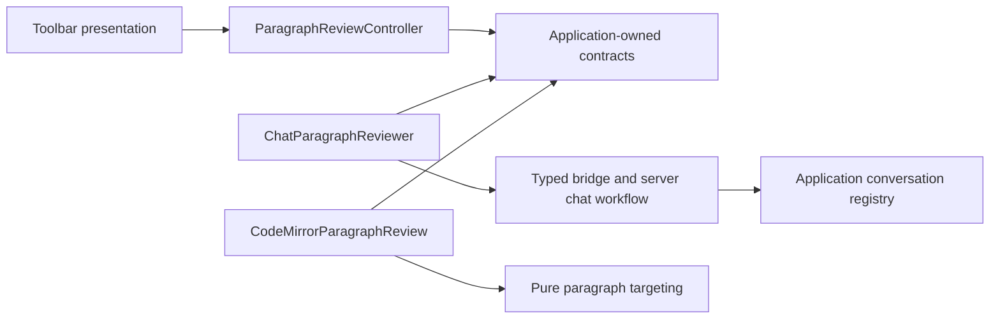

# Paragraph review module boundaries

Status: Active

Paragraph review is an independently owned feature with replaceable AI execution and editor adapters. The current behavior reviews one caret paragraph; these boundaries support future work without coupling feature policy to React, CodeMirror or chat wire formats. Implementation evidence is tracked in the [M32 checklist](../phase-1/milestone-32-paragraph-review-overview.md).

## Ownership and dependencies

| Module                                                                             | Owns                                                                                                                                                   | Must not own                                                           |
| ---------------------------------------------------------------------------------- | ------------------------------------------------------------------------------------------------------------------------------------------------------ | ---------------------------------------------------------------------- |
| `src/application/paragraph-review/contracts.ts`                                    | Feature request/result, captured paragraph, complete editor capability, AI port and observable state                                                   | Chat DTOs, provider SDKs, DOM or CodeMirror types                      |
| `src/application/paragraph-review/controller.ts`                                   | Eligibility, one-operation lifecycle, duplicate admission guard, cancellation, stale-target checks, Accept/Reject decisions and notifications          | Prompts, polling, HTTP/IPC, widgets or React effects                   |
| `src/application/paragraph-review/selection.ts`                                    | Pure paragraph targeting policy in UTF-16 offsets                                                                                                      | Editor state or rendering                                              |
| `src/adapters/paragraph-review/`                                                   | Current AI implementation: prompt asset loading/rendering, named conversation purpose, chat DTO translation, bounded polling, abort and remote cleanup | Editor mutation or UI state                                            |
| `src/editor/paragraph-review.ts` and `paragraph-suggestion.ts`                     | CodeMirror implementation of the editor port: caret access, decorations, widget layout, editability/body guards and undoable replacement               | AI transport, profiles, prompt text or workflow decisions              |
| `src/components/paragraph-review/ParagraphReviewButton.tsx`                        | Accessible toolbar presentation and dispatch to the controller                                                                                         | Eligibility rules, bridge access, request lifecycle or editor mutation |
| `src/components/useAppControllers.ts`, `App.tsx`, `src/application/controllers.ts` | Composition: instantiate/inject adapters, configure current context, synchronously invalidate on editor navigation, dispose with the app session       | A second implementation of the review workflow                         |
| `diary-application::chat::conversations`                                           | Bounded purpose-specific conversation ownership, opaque ID routing, iteration and cancellation on lease teardown                                       | HTTP/serde DTOs, model execution or feature prompts                    |
| `diary-api::chats`, Rust client bridge, TypeScript bridge                          | Authenticate/validate/translate transport DTOs; use named purposes `chat` and `paragraph_review`                                                       | Editor targeting and Accept/Reject policy                              |

Arrows describe source dependencies. Runtime calls from the controller reach the injected AI and editor ports. Only the outer composition root imports concrete adapters. The feature controller lives with the application session, not with a button mount. The editor port is a complete capability: a buffer either exposes `paragraphReview` or does not support the feature; individual methods are never optional.

Existing `src/application/review/` and `src/editor/review-extension.ts` own **candidate review** against saved revisions and durable server receipts. Caret paragraph review owns a captured editor target and applies through normal undo/autosave. They share neither lifecycle state nor acceptance semantics. The composition root coordinates mutual exclusion.

## Lifecycle and failure behavior

The controller transitions `idle → reviewing → suggestion → idle`. Empty, failed, unchanged or stale results return to idle without edits. A captured paragraph is not a saved revision: Accept rechecks the full captured body and current editability through the editor port before making a normal transaction. Reject removes the suggestion only.

Navigation, profile/language changes, blocking operations and app disposal abort the active operation and clear its suggestion. Operation identity rejects late results and stale decision callbacks. The AI adapter races cancellation and its ten-minute deadline against every awaited transport operation, including stalled reads. A late conversation-open response is closed when it eventually arrives. Poll timers are removed on cancellation. There is no automatic resubmission of uncertain requests.

The current transport reuses the agent chat execution pipeline with a separate named conversation purpose. The application conversation registry owns the two bounded slots and ID routing; handlers do not infer feature ownership from ID prefixes. Job cancellation and lease-close cancellation visit both slots. User-chat progress discovery remains restricted to the user-chat slot so it cannot adopt paragraph-review state. Paragraph review currently observes results through its adapter, without a resumable server review resource.

Instruction assets live in `assets/prompts/<agent-type>/review-paragraph.md`. The adapter validates their provider/default metadata and placeholders and substitutes JSON request data in one pass. They are client task-message assets; the server still prepares its ordinary versioned chat prompt and provider settings. These assets introduce neither model overrides nor prompt management. Unsupported or malformed assets fail closed.

The default review style is reflective: dwell on feelings and thoughts the facts
imply, without adding events. All four provider assets first ask for typo
correction in every sentence, preserving intentional wording and leaving uncertain
corrections unresolved. This is followed by internal hypothesis checking, evidence gathering, 5W1H as a loose guide, reflective
composition and a final factual audit. 5W1H imposes neither a required sentence
structure nor an order; natural reflective flow takes precedence. Clearly supported details from the supplied
D-1/D/D+1 context may enrich the same event; date proximity and source selection
alone establish neither a match nor truth. Contradictions and unresolved references
retain their uncertainty. Reflection may deepen expressed feelings or offer
restrained, tentative interpretation, but must not invent an experienced emotion,
motive, realization or belief. Sparse evidence permits a factual or unchanged
paragraph. The response remains one revised paragraph for the existing Accept/Reject
flow; there is no new style setting or model reasoning-effort override.

These instructions specify desired behavior, not a factuality guarantee. Automated
asset/transport checks do not establish model writing quality; live-model review
remains part of release qualification.

Prompt safeguards keep the paragraph as the baseline account: context may clarify
or enrich it but must not silently replace conflicting statements. A snippet date
does not establish an event date, and repetition does not establish reliability.
An uncertain typo is reconsidered during evidence checking rather than corrected
by guesswork. Plans, wishes, questions and reported statements retain their status.
Tentative wording alone does not justify an invented emotion; reflective edits
must have textual support and preserve the author's emotional direction and
intensity. Short examples demonstrate typo correction, supported context matching,
connecting expressed feelings and respecting an explicitly neutral response.
Empty or unusable context permits a paragraph-only revision without questions or
missing-context commentary. Instructions ask for a private review and a final
paragraph, not an exposed reasoning transcript or external tool use. The same
policy applies to every provider without assuming a particular reasoning capability.

`src/application/paragraph-review/context.ts` owns creation-time evidence mapping.
Composition supplies each freshly read source's parsed `created_at` header instant
as `creation_time`: UTC ISO timestamp, declared precision, optional diary-local
datetime and UTC offset, and a filename-conflict flag. No raw front matter, paths,
filename-only timestamp or filesystem time is sent. A missing or invalid header
instant yields null. The calendar `date` remains a navigation date, not a substitute
creation timestamp; the local projection uses the configured diary timezone.

A temporal evidence step follows hypothesis/evidence checking. Explicit temporal
wording takes priority. Where event time is absent, a matched snippet's creation
time can help interpret chronology or relative wording, and can support cautious
broad timing when contemporaneous reporting is supported. Conflicting metadata
must not fill missing event times; creation time alone never supplies an exact
event clock time. UTC/local day boundaries, missing local projection, retrospective
text and timestamp precision remain explicit limits. Examples distinguish a
morning recording from a dinner described as happening yesterday.

## Where future changes belong

- New targeting or structural paragraph rules: change `selection.ts` and policy tests.
- Multiple suggestions, richer decisions or review sessions: extend feature contracts/state and the controller, then the two port implementations as needed.
- A dedicated server paragraph API, streaming, model routing or structured AI output: replace/extend `ParagraphReviewer`; chat details stay inside the current adapter.
- Diff rendering, annotations or keyboard interactions: change the CodeMirror adapter/widget, preserving the editor port's guarded apply contract.
- Provider instructions: update the provider prompt asset and rendering tests.
- Saved review history, durable acceptance receipts or recovery: design explicit server application/storage ports; the current captured-body check does not provide those guarantees.

Do not prebuild those features in generic registries or UI conditionals. Extend the owning contract when there is a concrete requirement. Dependency checks in `scripts/frontend-boundaries.mjs` reject application imports of outer implementations, paragraph UI imports of execution implementations, AI adapters importing editor/UI code, and paragraph editor imports of transport/UI code.

## Validation

Controller tests run without React or CodeMirror and cover duplicate admission, stale targets, late completion, cancellation, disposal and retry. AI adapter tests cover named purpose, asset substitution, timeout, stalled reads and late-open cleanup. Editor tests cover suggestion placement and normal edit/autosave notifications. Server tests preserve user chat and verify independent close; the full gate protects shared transport and lease behavior. Live AI and native visual qualification remain separate evidence.

Paragraph Review has its own session profile selection in Settings > AI Agents, independent of Chat and Generation. Busy probe results are transient: background checks retry every fifteen seconds while busy, and a busy probe does not cancel an active paragraph review. All purposes still obey the shared server admission limit.

Review execution publishes content-free request/job identity and lifecycle stage
through the optional application-port progress callback. The controller captures
the operation's profile, ignores late callbacks, and clears progress on cancellation,
completion or failure. Global Messages observes that state on the shared two-second
cadence and honors the captured profile's saved progress toggle. This does not
publish the private review conversation into user-chat discovery or expose its prompt
and response bodies. Suggestion/completion and error notices remain independent.
