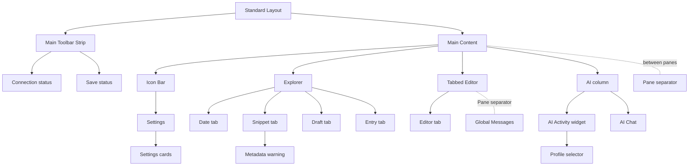

# UX information architecture

Status: Active

The Standard Layout is the conceptual containment model for the app. It records structure only; visual and interaction rules are in [ux-gui.md](ux-gui.md).

The Main Toolbar Strip spans the top; Main Content below it runs left to right: Icon Bar, Explorer, Tabbed Editor and the AI column. The toolbar holds the actions (Create Empty, Export, Command palette, Save, Generate), Save status and Connection status. The AI column stacks the AI Activity widget (Profile selectors, run summary, expandable details and results access) above AI Chat; it adds no blocking progress window. Global Messages sits below the Tabbed Editor, in the editor column only, with a horizontal Pane separator between them that resizes its height. Pane separators sit between Explorer, Tabbed Editor and AI Chat. Settings opens a labeled panel within the same local window, with a Go back button and a sidebar of sections (Status, Writing Language, Keyboard Shortcuts, Generation) shown as cards; it does not expose private config contents.

Date selects the working civil date; Snippet groups views of originals by source and local date. Draft lists Authentic access and transient candidates for that date, including results completed in the background (flagged by the Results badge) after navigating away; Entry lists saved Authentic dates, including explicitly created empty files. Authentic access from Draft and Entry opens the same Authentic resource/buffer in the Tabbed Editor; choosing a candidate in Draft activates that candidate's read-only Editor tab, which Generate has already opened. Opening a snippet does not change generation inclusion. AI Chat uses a snapshot of the active editor on each send. The containment model introduces no preview pane, financial workflow, separate saved draft, or history view.
