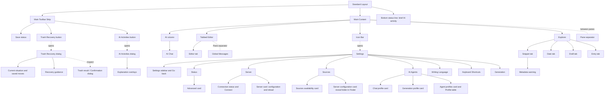

# UX information architecture

Status: Active

The Standard Layout is the conceptual containment model for the app. It records structure only; visual and interaction rules are in [ux-gui.md](ux-gui.md).

The Main Toolbar Strip spans the top; Main Content below it runs left to right: Icon Bar, Explorer, Tabbed Editor and the AI column. The toolbar holds the actions (Create Empty, Export, Command palette, Save, Generate, Trash Recovery, AI Activities), Save status. The AI column contains AI Chat. AI Activities opens a spacious modal with run details, cancellation, results and bitmap info buttons for explanation overlays; the bottom status line keeps a brief activity summary visible. Closing the modal does not stop work. Global Messages sits below the Tabbed Editor, in the editor column only, with a horizontal Pane separator between them that resizes its height. Pane separators sit between Explorer, Tabbed Editor and AI Chat. Settings replaces Main content within the same local window. Its sidebar has Go back followed by Status, Server, Sources, AI Agents, Writing Language, Keyboard Shortcuts and Generation. Each category displays cards: Status owns Advanced; Server owns connection and configuration reload; Sources owns source availability and the server configuration folder reveal action; AI Agents owns the Chat profile, Generation profile and Agent profiles cards. Profile selectors are contained in AI Agents. The [Settings contract](ux-gui.md#settings) defines each category's controls and behavior; private configuration contents stay outside the GUI.

Trash Recovery opens a modal dialog over the current window, separate from Settings and Global Messages. It contains Current situation, unfinished-move checks, saved operation inspection and recovery guidance. Inspect temporarily replaces it with the file result/confirmation dialog; closing the result or cancelling a continuation returns to Trash Recovery. Its top-right Close button or Escape returns focus to the toolbar button. Global Messages retains ordinary notices and may direct users to Trash Recovery; it contains no recovery controls. See the [Trash Recovery contract](ux-gui.md#trash-recovery).

AI Agents names the configured providers and their Settings category. AI Chat is the conversation surface and AI Activities is the activity dialog; these remain distinct components.

Date selects the working civil date; Snippet groups views of originals by source and local date. Draft lists Authentic access and transient candidates for that date, including results completed in the background (flagged by the Results badge) after navigating away; Entry lists saved Authentic dates, including explicitly created empty files. Authentic access from Draft and Entry opens the same Authentic resource/buffer in the Tabbed Editor; choosing a candidate in Draft activates that candidate's read-only Editor tab, which Generate has already opened. Opening a snippet does not change generation inclusion. AI Chat uses a snapshot of the active editor on each send. The containment model introduces no preview pane, financial workflow, separate saved draft, or history view.
