# UX information architecture

Status: Active

The Standard Layout is the conceptual containment model for the app. It records structure only; visual and interaction rules are in [ux-gui.md](ux-gui.md).

```mermaid
flowchart TB
  W[Standard Layout] --> T[Main Toolbar Strip]
  T --> PR[Paragraph Review button]
  T --> TR[Trash Recovery button]
  TR -. opens .-> RD[Trash Recovery dialog]
  RD --> RS[Current situation and saved moves]
  RD --> RG[Recovery guidance]
  RD -. Inspect .-> RR[Trash result / Confirmation dialog]
  W --> B[Main Content]
  B --> I[Icon Bar]
  B --> E[Explorer]
  B --> X[AI column]
  T --> AB[AI Activities button]
  AB -. opens .-> AA[AI Activities dialog]
  AA --> AH[Explanation overlays]
  W --> AS[Status line: AI activity, results and readiness]
  X --> A[AI Chat]
  B --> EC[Editor column]
  EC --> C[Tabbed Editor]
  EC --> G[Global Messages]
  C --> ET[Editor tab]
  C -. Pane separator .- G
  B -. between panes .- SP[Pane separator]
  I -. opens .-> S[Settings]
  S --> SB[Settings sidebar and Go back]
  S --> SV[Server]
  S --> ST[Status]
  ST --> AD[Advanced card]
  SV --> CS[Connection status and Connect]
  SV --> CF[Server card: configuration and reload]
  S --> SO[Sources]
  SO --> SA[Sources availability card]
  SO --> SF[Server configuration card: reveal folder in Finder]
  S --> AG[AI Agents]
  AG --> CP[Chat profile card]
  AG --> GP[Generation profile card]
  AG --> PP[Paragraph Review profile card]
  AG --> AP[Agent profiles card and Profile table]
  S --> WL[Writing Language]
  S --> GE[Generation]
  S --> SL[Status Line]
  S --> KS[Keyboard Shortcuts]
  N --> MW[Metadata warning]
  E --> D[Date tab]
  E --> N[Snippet tab]
  E --> F[Draft tab]
  E --> R[Entry tab]
```

The Main Toolbar Strip spans the top. Main Content runs left to right: Icon Bar, Explorer, editor column and AI column. The editor column contains the Tabbed Editor and Global Messages, separated by a horizontal Pane separator; vertical Pane separators resize Explorer, editor and AI Chat. Save status belongs in Global Messages. The Status line sits below Main Content and remains visible in Settings.

Settings replaces Main Content within the same local window. Its sidebar contains Go back and the [canonical categories and cards](ux-terms.md#settings-categories-and-cards). AI Agents contains the independent Chat, Generation and Paragraph Review profile selectors plus the Profile table. The [Settings contract](ux-gui.md#settings) defines interaction; private configuration contents stay outside the GUI.

Trash Recovery is a modal dialog over the current window, separate from Settings and Global Messages. It contains Current situation, unfinished-move checks, saved operations and recovery guidance. Inspect opens the file result/confirmation dialog. Recovery controls belong in these dialogs; Global Messages contains notices. See the [Trash Recovery contract](ux-gui.md#trash-recovery).

AI Agents names the configured providers and their Settings category. AI Chat is the conversation surface and AI Activities is the activity/results dialog. Closing that dialog keeps work running. Paragraph Review is a toolbar action with an inline editor suggestion; its conversation is isolated from AI Chat.

Date selects the working civil date; Snippet groups views of originals by source and local date. Draft lists Authentic access and transient candidates for that date, including results completed in the background (flagged by the Results badge) after navigating away; Entry lists saved Authentic dates, including explicitly created empty files. Authentic access from Draft and Entry opens the same Authentic resource/buffer in the Tabbed Editor; choosing a candidate in Draft activates that candidate's read-only Editor tab, which Generate has already opened. Opening a snippet does not change generation inclusion. AI Chat snapshots the active source or Authentic buffer on each send; a Candidate tab uses Authentic context instead. The [AI Chat contract](ux-gui.md#ai-chat) defines unsaved-edit disclosure. The containment model introduces no preview pane, financial workflow, separate saved draft, or history view.

The Command palette is a separate non-modal overlay below the Main Toolbar Strip, containing a search combobox and a scrollable recommended-command list. See the [keyboard contract](architecture/keyboard-shortcuts.md#command-palette-overlay) for ranking, dismissal and focus behavior.
